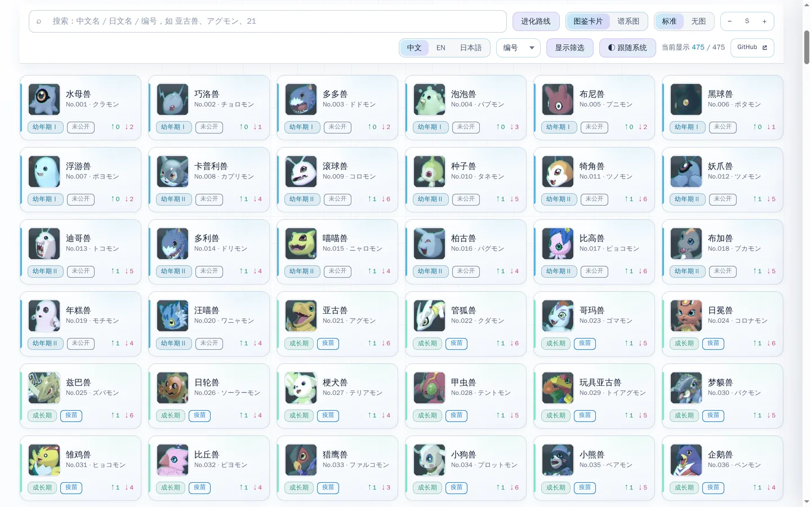
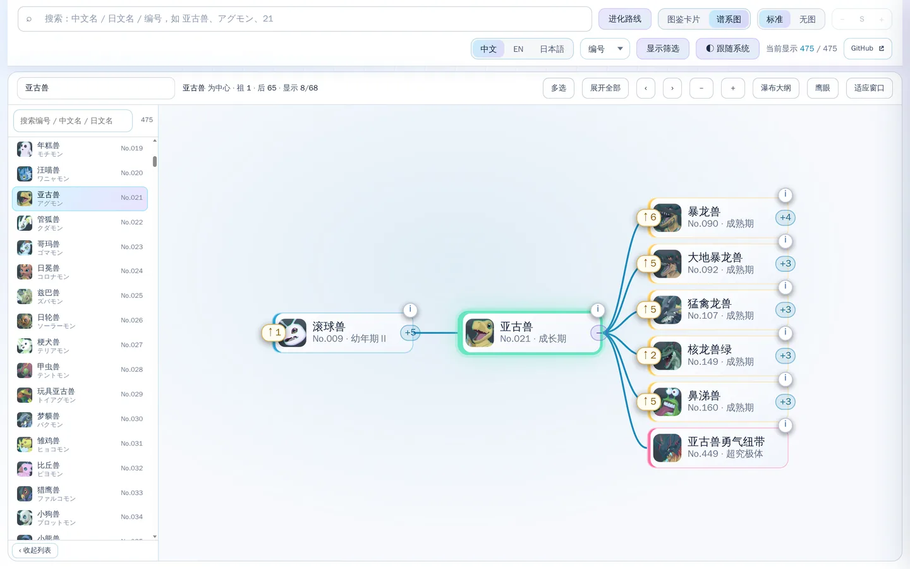
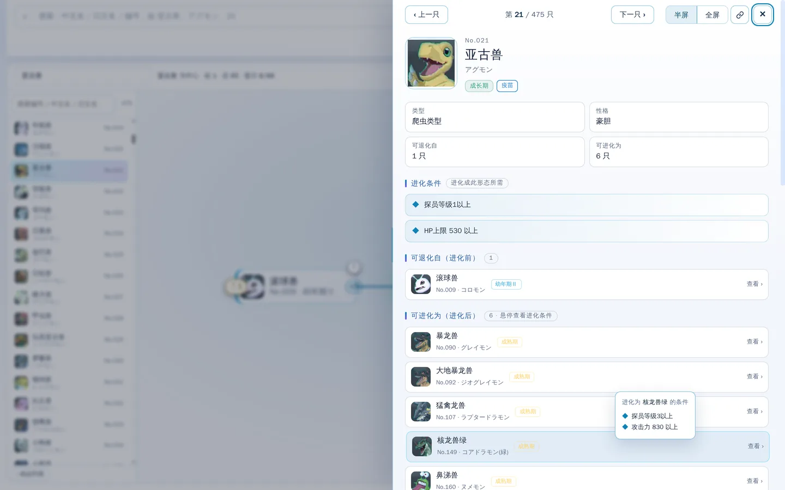

# Digimon Story: Time Stranger — Complete Codex & Evolution Graph

[简体中文](README.md) | **English** | [日本語](README.ja.md)

An **offline field guide plus interactive evolution graph** for *Digimon Story: Time Stranger*: base stats, Lv.1 / Lv.99 values, species and elemental resistances, skills and in-game profile text for all 475 Digimon, plus a full evolution network of 1,109 relations. The whole site is **a single `index.html`** — no build step, no dependencies, works offline.

| Entry | Link |
|---|---|
| Online (open on phone or desktop) | https://kazuko2012.github.io/digimon-time-stranger-codex/ |
| Offline single file (~2.9 MB, all icons inlined) | `dist/digimon-time-stranger-codex-single.html` (built by `python3 scripts/build_single.py`) |
| Source / commit history / issues | https://github.com/Kazuko2012/digimon-time-stranger-codex |
| Releases (latest only) | https://github.com/Kazuko2012/digimon-time-stranger-codex/releases |

> This repository contains **reference data and a viewer only**. It ships no game executable, no save files and nothing that could be used for piracy.

---

## Table of contents

- [The problem it solves](#the-problem-it-solves)
- [Screenshots](#screenshots)
- [Quick start in 30 seconds](#quick-start-in-30-seconds)
- [Use cases](#use-cases)
- [Feature overview](#feature-overview)
- [Where is that control?](#where-is-that-control)
- [Keyboard shortcuts](#keyboard-shortcuts)
- [Deep-link parameters (for sharing)](#deep-link-parameters-for-sharing)
- [Data and layout](#data-and-layout)
- [Run locally / build / deploy](#run-locally--build--deploy)
- [FAQ](#faq)
- [Changelog](#changelog)
- [Data sources and disclaimer](#data-sources-and-disclaimer)
- [License](#license)

---

## The problem it solves

In-game questions like "how do I evolve into this one", "what do I have to pass through to reach that", or "what else can this one become" are scattered across guide sites, wikis and forums — slow to search, buried under ads and tables. This project compresses all of it into one searchable, filterable, visualisable page:

- **475 Digimon × 1,109 evolution relations** built in; any two of them can be resolved into a shortest evolution chain plus alternative routes of the same length;
- **9 growth stages** (Baby I/II, Rookie, Champion, Ultimate, Mega, Ultra, Armor, Hybrid) colour-coded everywhere, so cards and the lineage graph are readable at a glance;
- The detail drawer carries **Lv.1 / Lv.99 stats, Lv.99 stats per personality (★ marks the species' starting personality), species resistances, elemental resistance table, skill list and the original profile text**;
- Full **Chinese / English / Japanese** localisation, with official names and profiles; the detail drawer can also switch language on its own;
- Works on phone, tablet and desktop; the single-file build can go on a USB stick or into a chat, and **opens offline with a double click**.

## Screenshots

**Card view**: the full 475 list, each card edged with its stage colour plus stage / attribute badges; search, view switch, "standard / no image" density and a card-size stepper on top; filters are collapsed by default and expand into stage / attribute / condition groups.



**Lineage view**: centred on any Digimon, with the ring and glow coloured by stage; `↑N` on the left fetches ancestors, `+N` on the right expands descendants, links are evolution relations (no arrows); the 475-entry sidebar switches centre, and the minimap keeps you oriented.



**Detail drawer**: evolution conditions, Lv.1 / Lv.99 values per personality, species resistances and skills, profile text; hovering any entry in the "evolves into" list reveals the conditions needed for that form.



## Quick start in 30 seconds

1. Open the online site (or double-click the single-file build).
2. Type a name or number into search (`21` is padded to `No.021`).
3. Click a card → the drawer shows **evolution conditions / evolves from / evolves into / stats / skills / profile text**.
4. For the big picture, switch to **Lineage** and pick any Digimon as the centre.
5. To see how to get from A to B, open **Evolution route**, pick start and target, then hit **Search**.

## Use cases

Organised by "what you are trying to do right now". Every scenario lists where to go and what to press; the online and offline builds behave identically.

### At a glance

| Your situation | Where to go | What to do |
|---|---|---|
| Which Digimon evolves into this, and under what conditions? | Cards → detail drawer | Search name/number → open the card → "Evolution conditions" and "Evolves from" |
| I own this one, what can it become? | Drawer, "Evolves into" list | Hover any entry to see that form's conditions |
| I want to raise A into B precisely | Lineage → "Evolution route" | Pick endpoints → tick "Allow devolution" → shortest chain and same-length alternatives |
| Where does this one sit in the family tree? | Lineage | Centre on it: `↑N` walks up, `+N` walks down, the waterfall outline goes generation by generation |
| Filling gaps in my collection | Cards + filters + sorting | Filter by stage/attribute/condition, sort by number, zero-padded number search |
| Planning stats and personality | Drawer, "Level stats" | Lv.1 vs Lv.99 plus per-personality values (★ starting personality) |
| Playing the Japanese release | Global language + per-card language | 中文 / EN / 日本語 on top; a drawer can switch one card only |
| Checking while playing on a phone | Full-screen drawer on mobile | Tap a card for full screen, `‹ 返回` back to the list, `‹ ›` steps through neighbours |
| Send one Digimon or a tree to a friend | Copy link (deep link) | Copy button in the drawer, or hand-write `?view=lineage&d=092` |
| Offline, USB stick, sharing | Single-file build | `dist/...-single.html`, double-click and it runs |

### 1. Early game: how is this Digimon evolved, and what does it need?

The most common use: you just met a Digimon you had never seen and want to work backwards and breed it.

1. Type a name or number into the search box (`112` becomes `No.112`; number matching is substring-based, so typing `0` lists every number containing `0`).
2. Open the card and read three blocks in the drawer (full screen on mobile):
   - **Evolution conditions** — e.g. No.112 Wizardmon needs "Tamer Lv. 3 or higher + SP cap 500 or higher + INT 630 or higher";
   - **Evolves from (previous forms)** — three sources (Biyomon / Impmon / Dracmon); click an entry to jump straight to it;
   - **Evolves into (next forms)** — the downstream forms.
3. Digimon names that appear inside condition text are normalised to the same name the card shows. "Evolution conditions" are both the requirements to evolve into that form and to devolve back.

> No need to open each target to check: hovering any entry in the "Evolves into" list pops up that form's condition card (tap works the same on mobile).

### 2. Target breeding: shortest chain from A to B

You want a particular Mega but don't know which intermediates are involved.

1. Click **Evolution route** on the toolbar (or open `?from=001&to=200` directly).
2. Start and target accept names or numbers (`021`, `No.21`, `21` all work), or open the `▾` list and pick with `↑↓` / `Enter`. Leaving the list empty shows all 475, filterable by stage / attribute / condition.
3. Tick **Allow devolution** if a devolution step is needed.
4. Press **Search** → you get the **shortest evolution chain** (step by step) and **alternatives of the same length**; click any route to highlight and centre it on the canvas, with the conditions for each step.

### 3. Stocktaking: what else can this one become?

1. Search for the Digimon you own and open its detail.
2. See how many forms are in **Evolves into**, and at which stages; "查看 ›" goes deeper.
3. For distant branches, use the footer button **"View everything before and after in the lineage map"** — it jumps to Lineage with that Digimon as centre and expands both directions.

### 4. Filling gaps in the collection

1. Click **Show filters** to expand stage / attribute / condition groups; they stack. **✕ Clear all filters** resets everything.
2. Sort by number / name / stage, and flip ascending / descending with `↑ / ↓` (changing the sort key returns to ascending).
3. To compact the list: set image mode to **No image**, or drop the card size to `XS`.
4. A persistent "showing N / 475" counter tells you whether filters and search are active; the filter summary strip above the list lets you remove items one by one.

### 5. Stat and personality planning

The lower half of the drawer:

- **Level stats**: HP, SP, ATK, DEF, INT, SPI, SPD and totals at Lv.1 and Lv.99, plus growth;
- **Lv.99 per-personality stats**: one row per personality, with ★ marking the species' **starting personality** — useful when deciding whether to reroll or invest;
- **Species / elemental resistances**: Vaccine, Data, Virus, Free, Variable, Unknown, and the fire/water/plant/ice/electric/ground/steel/wind/light/dark/neutral table;
- **Skill list**: signature skill plus level-learned skills, with power, hit count, SP, accuracy, target and extra effects.

### 6. Languages and Japanese names

- The toolbar `中文 / EN / 日本語` switches the **whole site**: names, stages, attributes, types, personalities, conditions, skill values, resistances and UI copy are all localised, and the choice is remembered (or use `?lang=ja`).
- For Japanese play the more useful feature is the **per-card language** in the drawer header: it switches only the card in front of you, while `‹ 返回`, `上一只 / 下一只`, `第 N / 475 只` and `半屏 / 全屏` always follow the main interface language.
- Hover cards and the evolves-from / evolves-into entries follow the card language too; closing the drawer returns to the main language.

### 7. The family tree as a whole

- Centre on any Digimon; the ring and glow are coloured by stage;
- Gold `↑N` on a node's left = N direct ancestors not yet drawn; clicking pulls one more layer up. Blue `+N` on the right expands descendants;
- Hovering a node highlights the whole chain "node → centre" and dims unrelated branches;
- The **waterfall outline** lists the entire tree generation by generation (including collapsed branches); clicking an entry expands the path and centres it;
- The **minimap** (bottom right) marks the centre in white and the viewport in cyan; click or drag to pan;
- **Multi-select** compares several routes side by side; **Fit to window** (or `F`) resets the view, the wheel zooms around the cursor, double-clicking empty space fits;
- The 475-entry sidebar collapses and re-expands; the in-lineage filter overlay shares the card view's filters and restores on returning to cards.

### 8. On a phone, while playing

- Tap any card → the detail takes the whole screen; `‹ 返回` at the top left goes back to the list;
- `‹ ›` in the header steps through neighbouring numbers with "第 N / 475 只" in between; the language group sits on a second row, left-aligned, clear of the copy / close buttons;
- On phones (≤900px) the header **scrolls with the content instead of sticking**, so it can never sit across the middle of the page covering "Evolution conditions";
- In the lineage view the sidebar collapses to a "› 展开列表" button at the bottom left, opening a full-screen 475 list; one finger pans, two fingers zoom;
- At iPad half-drawer widths the same narrow two-row header layout applies, with no overlap.

### 9. Sharing

The copy button in the drawer header turns the **current state** into a deep link (`view` plus `d` / `dr` / `lang` and so on); whoever opens it lands on the same Digimon or the same tree. By default the page **does not write state into the address bar**: close it and reopen and you are on the defaults — only links you deliberately copy carry parameters.

### 10. Offline and handing it to someone else

```bash
python3 scripts/build_single.py
# → dist/digimon-time-stranger-codex-single.html (icons inlined as base64, ~2.9 MB)
```

The single file works from a USB stick or a chat attachment: double-click and everything is there, identical to the online build (images, languages and lineage all live inside the file). To keep a versioned copy:

```bash
cp dist/digimon-time-stranger-codex-single.html dist/digimon-guide-v1.x.y.html
```

### 11. Maintaining the data / building on it

- Entries: `data/digimon-475.csv` (number, Chinese name, Japanese name, generation, attribute, type, personality, factor, traits, riding, evolution conditions, evolves from, evolves into, Lv.1 and Lv.99 stats with totals, species / elemental resistances, weaknesses and resistances, signature and extra skills, profile text);
- Stat detail: `data/digimon-lv99.csv` (Lv.99 values per personality);
- Icons: `assets/icons/001.webp … 475.webp` (112×112); sprite sheets `assets/sprites/sprite-56 / 112 / 160.webp`;
- Run `scripts/build_single.py` after editing — it prints `icons: 475` and warns about missing icons;
- Push to `main` and GitHub Actions publishes to Pages (`Settings → Pages → Source` = **GitHub Actions**).

## Feature overview

**Card view**

- Full 475 list with number, Chinese name, Japanese name, stage, attribute and conditions; stage-coloured edge and stage / attribute badges
- Search by Chinese name / Japanese name / number (substring match, zero padded), one-click clear
- Three stacked filter groups: stage (9 values) / attribute / conditions (none, level-gated, DLC); collapsed by default and expanded as an overlay so cards never jump
- Sorting: number / name / stage, ascending or descending; removable filter summary
- Image mode (standard / no image), loading mode (per-image vs sprite-sheet slice), five card sizes `XS S M L XL`
- Persistent "showing N / 475" counter
- Click a card to open the drawer (`Enter` / `Space` also open a focused card)

**Detail drawer**

- Header: previous / "第 N / 475 只" / next, per-card language, copy share link, close
- Basics: number, names, stage, attribute, type, personality, counts of previous and next forms
- Evolution conditions (hovering a list entry shows the target's conditions), evolves-from / evolves-into lists
- Lv.1 / Lv.99 stats and growth; Lv.99 values per personality (★ starting personality)
- Species and elemental resistance tables; skill list (signature / level skills with power, SP, accuracy, extra effects)
- Profile text; two footer shortcuts: search a route from here, or view everything before and after in the lineage map
- Side panel resizes by dragging (double-click for half width), half / full screen buttons, width and state remembered

**Lineage view**

- Centre on any Digimon and expand descendants and ancestors layer by layer, upward without limit
- `↑N` walks up, `+N` expands down; collapse and expand keep the current view without jumping
- Wheel zoom anchored at the cursor, drag to pan, double-click empty space to fit, plus a Fit button
- Hover highlights the centre chain and dims unrelated branches
- Evolution route query: shortest chain plus same-length alternatives, with "Allow devolution"
- Waterfall outline (generation by generation, collapsed branches included), minimap, multi-select comparison
- 475-entry sidebar (searchable, collapsible); in-lineage filter overlay

**Common**

- Three theme modes: follow system / light / dark (cycles on the button), remembered
- Remembers view, centre, search term and filter combination; **closing the page returns to defaults**, while share links still restore everything
- Deep links: any state can be copied as a URL
- Keyboard operation, focus rings, `aria-label`, `prefers-reduced-motion`
- Mobile full-screen drawer, non-sticky header, one- and two-finger gestures, drawer-style sidebar

## Where is that control?

| Location | Controls |
|---|---|
| Toolbar row 1 | Search, evolution route, view switch (cards / lineage), image mode (standard / no image), card size `− M ＋`, image loading (per-image / sprite), language, sort + `↑↓`, hide / show filters, theme (◐ follow system), current count, GitHub ↗ |
| Toolbar row 2 (filters open) | Stage / attribute / condition chips, `✕ Clear all filters` |
| Above the list | Filter summary strip (remove items individually) |
| Drawer, top right | Copy share link, close; `Half / Full` to their left |
| Drawer header | `‹ 上一只`, `第 N / 475 只`, `下一只 ›`, `中文 / EN / 日本語` |
| Lineage, top left | Search, centre history `‹ ›`, zoom `− / ＋`, fit, multi-select, expand all |
| Lineage, bottom | Evolution route panel (from the sidebar's right edge, listing routes to click), sidebar drawer (mobile) |
| Lineage, bottom right | Minimap |
| Page footer | Build version, GitHub link |

## Keyboard shortcuts

| Key | Action |
|---|---|
| `/` or `⌘K` / `Ctrl+K` | Focus search |
| `←` `→` | Previous / next number on cards; change centre in lineage; step cards while the drawer is open |
| `↑` `↓` | Move by number on cards / in lineage |
| `Alt`+`←` / `Alt`+`→` | Back / forward through lineage centres |
| `L` / `C` | Lineage / cards |
| `F` | Fit to window (lineage) |
| `Enter` / `Space` | Open the focused card / list item / node |
| `?` | Toggle the shortcut help |
| `Esc` | Close the topmost layer (help → route panel → drawer) |

## Deep-link parameters (for sharing)

| Parameter | Meaning | Example |
|---|---|---|
| `view` | `cards` or `lineage` | `?view=lineage` |
| `d` | Lineage centre number | `?view=lineage&d=092` |
| `n` / `dr` | Open a detail card directly | `?d=092&dr=112` |
| `q` | Prefill the search term | `?q=Agumon` |
| `from` / `to` | Prefill route endpoints and query immediately | `?from=001&to=200` |
| `lang` / `language` | `en` / `ja` | `?lang=ja` |
| `theme` | `light` / `dark` / `auto` | `?theme=dark` |
| `fs` / `fa` / `fc` | Stage / attribute / condition filters, `.` separated | `?fs=Mega.Ultimate` |
| `dens` | `normal` / `none` (no image) | `?dens=none` |
| `spr` | `file` per-image / `sprite` sprite sheet | `?spr=sprite` |
| `size` | Card width 168 / 196 / 240 / 296 / 360 | `?size=296` |
| `thm` | Legacy theme parameter | `?thm=light` |

## Data and layout

```
.
├── index.html                # the page itself — the only file you need to run it
├── assets
│   ├── icons/                # 475 icons, 001.webp … 475.webp, 112×112
│   └── sprites/              # sprite sheets: sprite-56 / 112 / 160.webp
├── data
│   ├── digimon-475.csv       # entries (names/stage/attribute/conditions/stats/resistances/skills/profile)
│   └── digimon-lv99.csv      # Lv.99 values per personality
├── scripts
│   └── build_single.py       # builds the self-contained offline single file (icons as base64)
├── docs                      # real screenshots used by the READMEs
│   ├── screenshot-deck.webp
│   ├── screenshot-lineage.webp
│   └── screenshot-drawer.webp
├── dist/                     # build output (single file), not part of the source
└── .github/workflows/pages.yml   # publishes to GitHub Pages on push to main
```

## Run locally / build / deploy

**Run locally**

```bash
python3 -m http.server 8000
# open http://localhost:8000
```

Double-clicking `index.html` usually works too; a local server is safer where a browser restricts local image access.

**Build the single file**

```bash
python3 scripts/build_single.py
# produces dist/digimon-time-stranger-codex-single.html (~2.9 MB)
```

**Deploy**

Pushing to `main` publishes the site via GitHub Actions at `https://kazuko2012.github.io/digimon-time-stranger-codex/`. Set **Settings → Pages → Source** to **GitHub Actions**.

> If the deploy step reports `Fetching artifact metadata failed`, re-run the workflow once. Do not use "rerun failed jobs" — that produces two `github-pages` artifacts and fails again.

## FAQ

**Stats differ from my game?**
Values are compiled from a Japanese guide site (DLC included); individual entries may differ from your save or patch. The game is authoritative.

**Why does a condition just say "none"?**
That form is obtained directly (initial or via a specific route) with no level or item requirement — e.g. the initial Baby I forms.

**Why doesn't the header stick on mobile?**
Desktop keeps it sticky so previous/next is always reachable; on phones it scrolls with content on purpose, because iOS Safari's sticky positioning inside a scrolling drawer floats mid-page and covers the text. Use `‹ 返回` at the top left, or browse the list instead.

**Do theme and view survive a refresh?**
Theme, view and similar state survive refresh and back navigation, but **closing the page and reopening returns to defaults**, so an old filter or centre is never silently restored. Deliberately copied share links are unaffected.

**Can it run offline?**
Yes. The single-file build inlines all 475 icons as base64 and works with the network off.

**Does it include game files?**
No. The repository holds guide data and the viewer code only.

## Changelog

### v1.10.7 — 2026-11-22 · Personality table tooltip relayout

- The tooltip is now "title + line items": name and quadrant on the first line, then per-level growth, the Lv.99 delta and the total each on its own line, so numbers are no longer split by the list separator
- The comparison base is stated explicitly ("relative to ★ Reckless"), and the total row shows the delta against that base with coloured +/- signs
- On touch devices, tapping a personality row opens the detail and tapping again closes it; the note under the table mentions this

##### v1.10.6 · Card personality and evolution conditions use the official 16 names

- Fixed the mismatch between the card's "Personality" field (old tags such as 蛮勇 / 随和 / 护崽 / 健谈) and the personality table: all tags now map to the official 16 and carry the quadrant plus bonus, e.g. "匹夫之勇（勇猛 +攻击）" / "Overprotective（Philanthropy +SPI）"
- Evolution conditions of the form "X's personality is …" now use the official names too, and on EN / JA the Digimon name in that line is localised (`Ankylomon / Personality: Overprotective`, `アンキロモン / 性格：過保護`)
- The English legend reads "+ATK" instead of "+ ATK", so on narrow screens `Valor +` and `ATK)` no longer split into two lines

##### v1.10.5 — Official personality names and the four quadrants

- The personality table now uses the official localised names (zh: 慈爱 / 牺牲奉献 / 包容力 / 过度保护 / 热血 / 勇敢 / 匹夫之勇 / 胆识非凡 / 天启 / 坏点子 / 聪颖 / 战略家 / 投机分子 / 和蔼可亲 / 善于社交 / 饶富人情味)
- English and Japanese labels corrected to the official ones: Adoring / Devoted / Tolerant / Overprotective / Zealous / Brave / Reckless / Daring / Enlightened / Sly / Astute / Strategic / Opportunistic / Friendly / Sociable / Compassionate, and 慈愛 / 献身的 / 包容力 / 過保護 / 熱血 / 勇敢 / 蛮勇 / 豪胆 / 天啓 / 悪知恵 / 聡慧 / 戦略家 / 日和見 / 気さく / 社交的 / 人情家
- Each row carries a quadrant colour dot plus a legend underneath: Philanthropy (+SPI) / Valor (+ATK) / Wisdom (+INT) / Amicability (+DEF); the hover tooltip names the quadrant too
- The table scrolls horizontally on narrow screens, so long names no longer wrap

##### v1.10.4 — Renamed to Complete Codex & Evolution Graph

- The project is renamed to match what it actually contains: not just evolution links but stats, resistances, skills and profile text for all 475 Digimon
- Repository `digimon-time-stranger-guide` → `digimon-time-stranger-codex`; the site now lives at https://kazuko2012.github.io/digimon-time-stranger-codex/
- Page title, hero heading, footer repo link and the single-file output name (`digimon-time-stranger-codex-single.html`) updated accordingly

##### v1.10.3 — Mobile header no longer floats over content

- On phones and narrow screens (≤900px) the detail header is no longer `sticky`: on iOS Safari, sticky positioning inside the scrolling drawer floats mid-page and covers text such as "Evolution conditions" and "Evolves from"
- The narrow header now scrolls with the content, and its background fill was removed so no bar can sit across the middle of a card
- Desktop and wide screens (>900px) keep the sticky header, so previous/next stays visible while scrolling

> Older versions live in [Releases](https://github.com/Kazuko2012/digimon-time-stranger-codex/releases) — only the latest release is kept; older ones are deleted automatically.

## Data sources and disclaimer

- Stats and profile text are compiled from the Japanese guide site AppMedia for *Time Stranger* (DLC Digimon included)
- English and Japanese names and profiles come from the official [digimon.net](https://digimon.net/) encyclopedia
- Evolution conditions are freely translated; wording may differ from the in-game text, which is authoritative
- Icons come from in-game assets and are used for this fan reference only

This is a non-commercial fan project. All Digimon characters, names and artwork belong to Bandai Namco Entertainment and their respective owners. The code is released under MIT; that licence does **not** extend to third-party game assets. Should a rights holder object, the relevant content will be taken down immediately.

## License

Code: MIT (see [`LICENSE`](LICENSE)). Assets: rights remain with their respective owners; for study and personal reference only.
