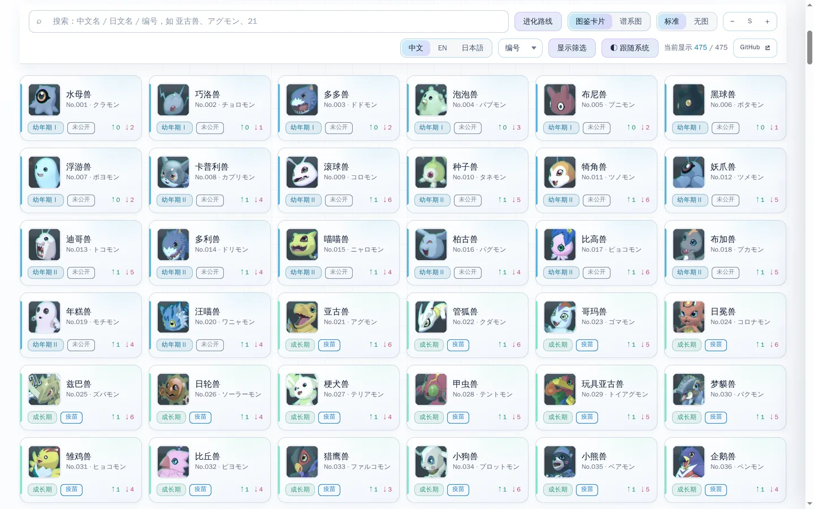
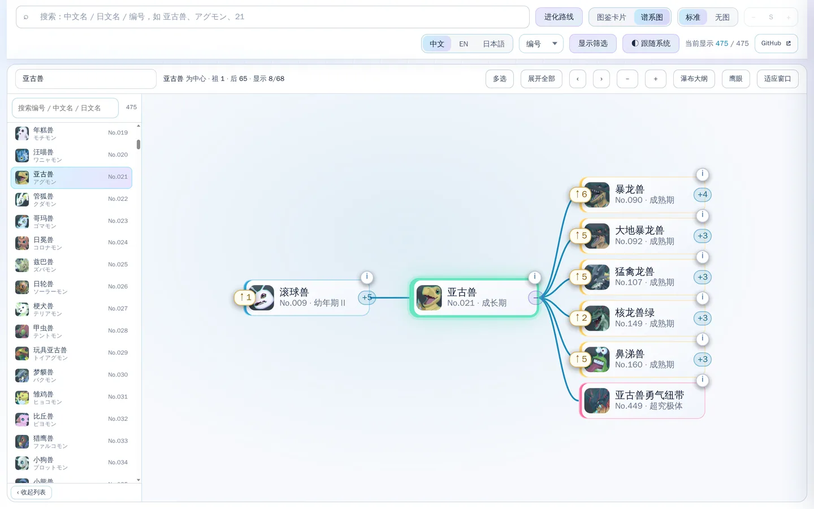
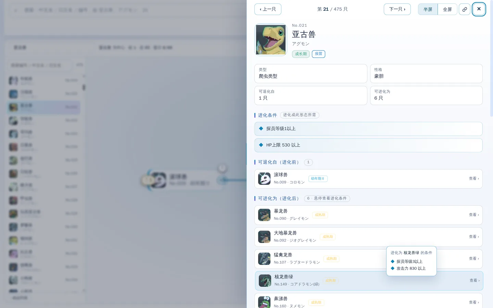

# デジモンストーリー タイムストレンジャー — 全デジモン図鑑と進化系統図

[简体中文](README.md) | [English](README.en.md) | **日本語**

『デジモンストーリー タイムストレンジャー』の**オフライン図鑑＋インタラクティブな進化系統図**です。全 475 体の基本データ、Lv.1 / Lv.99 のステータス、種族・属性耐性、スキル、図鑑プロフィールに加え、1,109 件の進化関係からなる進化ネットワーク全体を収録しています。サイトは**`index.html` 1 枚のみ**で、ビルド不要・依存なし・ネットワークなしで開けます。

| 入口 | リンク |
|---|---|
| オンライン版（スマホ／PC でそのまま） | https://kazuko2012.github.io/digimon-time-stranger-codex/ |
| オフライン単一ファイル（約 2.9 MB、アイコン全内蔵） | `dist/digimon-time-stranger-codex-single.html`（`python3 scripts/build_single.py` で生成） |
| ソース／更新履歴／不具合報告 | https://github.com/Kazuko2012/digimon-time-stranger-codex |
| リリース（最新のみ保持） | https://github.com/Kazuko2012/digimon-time-stranger-codex/releases |

> 本リポジトリは**図鑑データと閲覧ツールのみ**を収録しています。ゲーム本体、セーブデータ、その他不正な内容は含みません。

---

## 目次

- [何を解決するのか](#何を解決するのか)
- [スクリーンショット](#スクリーンショット)
- [30 秒で使い始める](#30-秒で使い始める)
- [利用シーン](#利用シーン)
- [機能一覧](#機能一覧)
- [画面のどこに何があるか](#画面のどこに何があるか)
- [キーボードショートカット](#キーボードショートカット)
- [ディープリンクパラメータ（共有用）](#ディープリンクパラメータ共有用)
- [データとディレクトリ構成](#データとディレクトリ構成)
- [ローカル実行／ビルド／デプロイ](#ローカル実行ビルドデプロイ)
- [よくある質問](#よくある質問)
- [更新履歴](#更新履歴)
- [データ出典と免責](#データ出典と免責)
- [ライセンス](#ライセンス)

---

## 何を解決するのか

「このデジモンはどうやって進化するのか」「あの形態まで育てるには何を経由するのか」「手持ちは他に何になれるのか」——答えは攻略サイトや Wiki、掲示板に散らばっていて、検索の手間が大きく、広告や表に邪魔されがちです。本プロジェクトはそれを、検索・絞り込み・グラフ閲覧ができる 1 ページに集約します。

- **475 体 × 1,109 件の進化関係**を内蔵し、任意の 2 体の最短進化ルートと同長の代替ルートを算出；
- **9 つの成長段階**（幼年期Ⅰ/Ⅱ、成長期、成熟期、完全体、究極体、超究極体、アーマー体、ハイブリッド体）を段階ごとに色分けし、カードでも系統図でも一目で判別；
- 詳細ドロワーには **Lv.1／Lv.99 の 7 項目、性格別 Lv.99 値（★ はその種の初期性格）、種族耐性、属性耐性表、スキル表、図鑑原文**を収録；
- **中国語／English／日本語**の全画面ローカライズ。名称とプロフィールは公式図鑑由来。詳細カードは単体でも言語を切り替え可能；
- スマホ・タブレット・PC で利用可。単一ファイル版は USB メモリやチャットで配布でき、**オフラインでもダブルクリックで起動**。

## スクリーンショット

**カードビュー**：475 体の一覧。カード左端に段階色の帯と段階／属性バッジ。上部に検索、ビュー切替、「標準／画像なし」の密度、カードサイズのステッパー。絞り込みは既定で折りたたみ、「絞り込みを表示」で段階／属性／条件の 3 グループが展開します。



**系統図ビュー**：任意のデジモンを中心に、中心リングと発光が段階色で描かれます。ノード左の `↑N` で祖先、右の `+N` で子孫を展開、リンクは進化関係（矢印なし）。左の 475 体リストで中心を切替、右下のミニマップで位置を把握できます。



**詳細ドロワー**：進化条件、性格別の Lv.1／Lv.99 値、種族耐性とスキル、図鑑プロフィール。「進化先」リストの任意の項目にカーソルを合わせると、その形態に必要な条件が表示されます。



## 30 秒で使い始める

1. オンライン版（または単一ファイル版のダブルクリック）で開く。
2. 検索欄に名前か番号を入力（`21` は自動で `No.021` に）。
3. カードをクリック → ドロワーで**進化条件／退化元／進化先／ステータス／スキル／図鑑プロフィール**を確認。
4. 全体像を見たいときは上部の「系統図」へ。任意の 1 体を中心に指定。
5. A から B への道筋は「進化ルート」を開き、始点と終点を選んで「検索」。

## 利用シーン

「いま何をしたいか」で整理しています。各シーンに操作手順と対応機能を示します。オンライン版と単一ファイル版は同じ動作です。

### 早見表

| 状況 | 使う場所 | 操作 |
|---|---|---|
| このデジモンはどう進化するのか、条件は何か | カード → 詳細ドロワー | 名前／番号で検索 → カードを開く →「進化条件」と「退化元（進化前）」 |
| 手持ちのこの子は何になれるのか | ドロワー「進化先」リスト | 任意の項目にホバーすると、その形態の進化条件が出る |
| A から B へ正確に育てたい | 系統図 →「進化ルート」 | 始点／終点を選ぶ →「退化を許可」→ 最短チェーンと同長の代替 |
| この子の系統上の位置を知りたい | 系統図 | 中心に指定：`↑N` で上流、`+N` で下流、滝リストで世代ごとに確認 |
| 図鑑の抜けを埋めたい | カード＋絞り込み＋並び替え | 段階／属性／条件で絞る、番号順、ゼロ埋め検索 |
| ステータスと性格を設計したい | ドロワー「レベル値」 | Lv.1／Lv.99 の対比＋性格別の値（★ 初期性格） |
| 日本語版を遊んでいる／和名を確認したい | 全体言語＋カード単体言語 | 上部の 中文／EN／日本語。ドロワー内でカード 1 枚だけ切替も可 |
| スマホでゲームしながら調べたい | スマホの全画面ドロワー | カードをタップで全画面、`‹ 返回` で一覧、上部 `‹ ›` で隣の番号へ |
| 1 体や系統図を人に送りたい | リンク共有（ディープリンク） | ドロワー右上のコピーボタン、または `?view=lineage&d=092` を直接 |
| オフライン・USB・配布 | 単一ファイル版 | `dist/...-single.html` をダブルクリック |

### 1. 序盤：この進化はどうやって来るのか、条件は何か

最も多い使い方です。見たことのないデジモンに出会い、さかのぼって育成したいとき。

1. 上部の検索欄に名前・和名・番号を入力（`112` は自動で `No.112`。番号は部分一致なので `0` を入れると `0` を含む番号がすべて出ます）。
2. カードを開き、ドロワー（スマホでは全画面）で 3 つのブロックを確認：
   - **進化条件**：例として No.112 ウィザーモンは「テイマーLv.3以上＋SP上限500以上＋知力630以上」；
   - **退化元（進化前）**：3 体の由来（ピヨモン／インプモン／ドラクモン）。項目クリックでその図鑑へ移動；
   - **進化先（進化後）**：その先の形態。
3. 条件内のデジモン名はカード表示名に統一済み。「進化条件」はその形態へ進化する条件であり、退化して戻る条件でもあります。

> 1 体ずつ開いて確認する必要はありません。「進化先」リストの任意の項目に**カーソルを合わせる**と、その形態の進化条件カードが浮かびます（スマホではタップ）。

### 2. 目標育成：A から B への最短チェーン

ある究極体を育てたいが、途中で誰を経由するか分からないとき。

1. 上部の「進化ルート」をクリック（または `?from=001&to=200` を直接開く）。
2. 始点／終点は名前・和名・番号（`021` / `No.21` / `21` すべて可）で入力でき、`▾` で候補リストを開き `↑↓` で選択、`Enter` で確定。空欄なら全 475 体を一覧表示し、段階／属性／条件で絞り込みも可能。
3. 退化を挟むルートが必要なら「退化を許可」にチェック。
4. 「検索」を押すと**最短進化チェーン**（各段階の中間形態）と**同長の代替ルート**が出力され、任意のルートをクリックするとマップ上で強調・中央寄せされ、各段階の条件も表示されます。

### 3. 手持ちの棚卸し：この子は他に何になれるのか

1. カードページで手持ちの 1 体を検索し、詳細を開く。
2. 「進化先（進化後）」に何体あるか、それぞれどの段階かを確認。項目右の「查看 ›」でさらに深く辿れます。
3. 遠い分岐を見たいときは、ドロワー下部の「系統図で『XX』の前後すべてを見る」を押すと、そのまま系統図へ移動し上下世代が展開されます。

### 4. 図鑑の抜けを埋める

1. 「絞り込みを表示」で段階／属性／条件の 3 グループを展開。組み合わせ可。`✕ 絞り込みをすべて解除` で一括リセット。
2. 並び替えで番号／名前／段階を選択、`↑ / ↓` で昇順・降順（並び替え方法を変えると昇順に戻ります）。
3. 一覧を圧縮したいときは、画像モードを「画像なし」に、またはカードサイズを `XS` に。
4. 上部に常時「現在 N / 475」を表示し、絞り込みや検索が効いているかが一目で分かります。一覧上部の絞り込みサマリーは項目単位で解除できます。

### 5. ステータスと性格の設計

詳細ドロワーの下半分：

- **レベル値**：Lv.1／Lv.99 の HP、SP、攻、防、知、精、敏、合計と成長値；
- **Lv.99 性格別ステータス**：性格ごとに 1 行、★ がその種の**初期性格**。性格の振り直しや投資判断に；
- **種族耐性／属性耐性**：ワクチン／データ／ウィルス／フリー／可変／不明 と、火水草木氷雷地鋼風光闇無 の耐性記号；
- **スキル表**：専用スキルとレベル習得スキル。威力、回数、SP、命中、対象、追加効果を収録。

### 6. 言語と和名の照合

- 上部ツールバーの `中文 / EN / 日本語` は**サイト全体**の切替です。名称、段階、属性、タイプ、性格、条件、スキル値、耐性、UI 文言がすべてローカライズされ、選択は記憶されます（`?lang=ja` でも直行可）。
- 日本語版を遊ぶときに便利なのが**詳細カード単体の言語**です。ドロワー上部の `中文 / EN / 日本語` は目の前のカードだけを切り替え、`‹ 返回`、`上一只 / 下一只`、`第 N / 475 只`、`半屏 / 全屏` といった UI 文言は常にメイン画面の言語に従います。
- ホバー条件カードや進化前後のリスト項目もカードの言語に追従し、ドロワーを閉じるとメイン画面の言語に戻ります。

### 7. 系統図を俯瞰する

- 任意の 1 体を中心に、中心リングと発光が段階色で描画；
- ノード左の金色 `↑N` は未表示の直系進化元が N 件あることを示し、クリックで 1 層上へ。右の青い `+N` で子孫を 1 層展開；
- ノードにホバーすると「そのノード → 中心」のチェーン全体が強調され、無関係な枝が淡くなります；
- **滝リスト（ウォーターフォール一覧）**は系統全体を世代ごとに列挙（折りたたみ枝を含む）。項目クリックで経路が展開され中央に寄ります；
- **ミニマップ**（右下）は中心を白枠、現在の表示範囲を水色枠で示し、クリック／ドラッグで素早く移動；
- **複数選択**で複数のルートを並べて比較。「表示範囲に合わせる」（または `F`）で一発リセット、ホイール拡大はカーソル基準、空白のダブルクリックでフィット；
- 左の 475 体リストは折りたたみ／展開が可能。系統図内の絞り込みオーバーレイはカードページの絞り込みと共通で、カードページへ戻ると復元されます。

### 8. スマホでゲームしながら調べる

- カードページで任意の 1 体をタップ → 詳細が全画面に。左上 `‹ 返回` で一覧へ；
- 上部の `‹ ›` で隣の番号へ移動し、中央に「第 N / 475 只」。言語グループは 2 行目の左寄せで、右上のコピー／閉じるボタンと重なりません；
- スマホ（≤900px）では上部バーが**内容と一緒にスクロールし、固定されません**。「進化条件」の上に横たわって本文を隠すことはありません；
- 系統図では左リストが左下の「› 一覧を展開」に畳まれ、全画面の 475 体リストが開きます。キャンバスは 1 本指でパン、2 本指でピンチ；
- iPad の半画面ドロワー幅でも同じ狭幅 2 行レイアウトになり、重なりはありません。

### 9. 共有

ドロワー右上のコピーボタンは**現在の状態**をディープリンクにします（`view` と `d` / `dr` / `lang` など）。開いた相手は同じ 1 体／同じ系統図に着地します。ページは既定で**アドレスバーに状態を書きません**。通常利用で閉じて開き直すと既定状態に戻り、自分でコピーした共有リンクだけがパラメータを持ちます。

### 10. オフライン／人に渡す

```bash
python3 scripts/build_single.py
# → dist/digimon-time-stranger-codex-single.html（アイコンを base64 で内蔵、約 2.9 MB）
```

単一ファイル版は USB メモリでもチャット添付でもそのまま動きます。ダブルクリックで起動し、オンライン版と同じ機能（画像、言語、系統図すべてファイル内）です。バージョン名を付けて保管する場合：

```bash
cp dist/digimon-time-stranger-codex-single.html dist/digimon-guide-v1.x.y.html
```

### 11. データを自分で保守する／二次開発

- 項目：`data/digimon-475.csv`（番号、中国語名、和名、世代、属性、タイプ、性格、因子、特性、デジタルライド、進化条件、退化元、進化先、Lv.1 と Lv.99 の 7 項目と合計、種族／属性耐性、弱点・耐性、専用・追加スキル、図鑑説明）；
- ステータス明細：`data/digimon-lv99.csv`（性格別 Lv.99 値）；
- アイコン：`assets/icons/001.webp … 475.webp`（112×112）、スプライト `assets/sprites/sprite-56 / 112 / 160.webp`；
- 編集後は `scripts/build_single.py` を実行して検証（`icons: 475` を出力、欠落があれば警告）；
- `main` へ push すると GitHub Actions が Pages へ公開（`Settings → Pages → Source` を **GitHub Actions** に）。

## 機能一覧

**カードビュー**

- 全 475 体の一覧：番号、中国語名、和名、段階、属性、進化条件。カード左端の段階色帯と段階／属性バッジ
- 中国語名／和名／番号で検索（番号は部分一致・ゼロ埋め）、`✕` で一括クリア
- 3 グループの絞り込み（段階 9 種／属性／条件〈条件なし・レベル条件・DLC〉）。既定は折りたたみで、「絞り込みを表示」によりオーバーレイ展開しカードを押し動かしません
- 並び替え：番号／名前／段階＋昇順・降順、絞り込みサマリーは項目単位で削除可
- 画像モード 2 種（標準／画像なし）＋読み込み方式 2 種（個別読み込み／スプライト一括）＋カードサイズ 5 段 `XS S M L XL`
- 常時カウンタ「現在 N / 475」
- カードクリックで詳細ドロワー（`Enter` / `Space` でもフォーカス中のカードを開く）

**詳細ドロワー**

- 上部バー：前へ／「第 N / 475 只」／次へ、カード単体の言語、共有リンクのコピー、閉じる
- 基本：番号、中国語／和名、段階、属性、タイプ、性格、退化元と進化先の数
- 進化条件（リスト項目のホバーで対象形態の条件を表示）、退化元／進化先リスト
- Lv.1／Lv.99 ステータスと成長値、性格別 Lv.99 値（★ 初期性格）
- 種族耐性・属性耐性表、スキル表（専用／レベルスキル、威力・SP・命中・追加効果）
- 図鑑プロフィール原文、下部に 2 つのショートカット（ここを起点にルート検索／系統図で前後すべてを表示）
- サイドパネルはドラッグで幅変更（ダブルクリックで半画面）、上部に「半屏 / 全屏」、幅と状態は記憶

**系統図**

- 任意の 1 体を中心に子孫・祖先を層ごとに展開、上流は無制限
- `↑N` で上流、`+N` で下流。折りたたみ／展開しても視点は飛ばない
- ホイール拡大（カーソル基準）、ドラッグでパン、空白ダブルクリックでフィット、フィットボタン
- ホバーで中心チェーンを強調し、無関係な枝を淡色化
- 進化ルート検索：最短チェーン＋同長の代替、「退化を許可」に対応
- 滝リスト（世代別、折りたたみ枝を含む）、ミニマップ、複数選択でのルート比較
- 左の 475 体リスト（検索可・折りたたみ可）、系統図内の絞り込みオーバーレイ

**共通**

- テーマ 3 モード：システムに従う／ライト／ダーク（ボタンで循環）、選択は記憶
- ビュー、中心、検索語、絞り込みの組み合わせを記憶。**ページを閉じると既定に戻る**が、共有リンクからは復元可能
- ディープリンク：どの状態も URL としてコピー可能
- キーボード操作、フォーカスリング、`aria-label`、`prefers-reduced-motion`
- モバイル：全画面ドロワー、固定しない上部バー、1 本指／2 本指操作、左リストのドロワー化

## 画面のどこに何があるか

| 位置 | コントロール |
|---|---|
| 上部 1 行目 | 検索、進化ルート、ビュー切替（カード／系統図）、画像モード（標準／画像なし）、カードサイズ `− M ＋`、画像読み込み（個別／スプライト）、言語、並び替え＋`↑↓`、絞り込みの表示／非表示、テーマ（◐ システムに従う）、現在の件数、GitHub ↗ |
| 上部 2 行目（絞り込み展開時） | 段階／属性／条件のチップ、`✕ 絞り込みをすべて解除` |
| 一覧の上 | 絞り込みサマリー（項目単位で削除） |
| ドロワー右上 | 共有リンクのコピー、閉じる。左隣が `半屏 / 全屏` |
| ドロワー上部 | `‹ 上一只`、`第 N / 475 只`、`下一只 ›`、`中文 / EN / 日本語` |
| 系統図 左上 | 検索、中心履歴 `‹ ›`、拡大／縮小 `− / ＋`、フィット、複数選択、すべて展開 |
| 系統図 下部 | 進化ルートパネル（左リストの右端から、ルートを列挙してクリック選択）、一覧の展開（スマホ） |
| 系統図 右下 | ミニマップ |
| ページ下部 | ビルドバージョン、GitHub リポジトリへのリンク |

## キーボードショートカット

| キー | 動作 |
|---|---|
| `/` または `⌘K` / `Ctrl+K` | 検索欄にフォーカス |
| `←` `→` | カードで隣の番号へ、系統図で中心を変更、ドロワー表示中は前後のカードへ |
| `↑` `↓` | カード／系統図で番号順に前後移動 |
| `Alt`+`←` / `Alt`+`→` | 系統図の中心履歴を戻る／進む |
| `L` / `C` | 系統図／カード |
| `F` | 表示範囲に合わせる（系統図） |
| `Enter` / `Space` | フォーカス中のカード／リスト項目／ノードを開く |
| `?` | ショートカットヘルプの開閉 |
| `Esc` | 最前面のレイヤーを閉じる（ヘルプ → ルートパネル → ドロワー） |

## ディープリンクパラメータ（共有用）

| パラメータ | 内容 | 例 |
|---|---|---|
| `view` | `cards` カード／`lineage` 系統図 | `?view=lineage` |
| `d` | 系統図の中心番号 | `?view=lineage&d=092` |
| `n` / `dr` | 指定の詳細カードを直接開く | `?d=092&dr=112` |
| `q` | 検索語を事前入力 | `?q=アグモン` |
| `from` / `to` | ルート検索の始点／終点を事前入力し自動実行 | `?from=001&to=200` |
| `lang` / `language` | `en` / `ja` | `?lang=ja` |
| `theme` | `light` / `dark` / `auto` | `?theme=dark` |
| `fs` / `fa` / `fc` | 段階／属性／条件の絞り込み（`.` 区切り） | `?fs=究極体.完全体` |
| `dens` | `normal` / `none`（画像なし） | `?dens=none` |
| `spr` | `file` 個別／`sprite` スプライト | `?spr=sprite` |
| `size` | カード幅 168 / 196 / 240 / 296 / 360 | `?size=296` |
| `thm` | 旧テーマパラメータ（互換） | `?thm=light` |

## データとディレクトリ構成

```
.
├── index.html                # メインページ（実行に必要な唯一のファイル、全データとロジックを内包）
├── assets
│   ├── icons/                # 475 枚のアイコン、001.webp … 475.webp、112×112
│   └── sprites/              # スプライト：sprite-56 / 112 / 160.webp
├── data
│   ├── digimon-475.csv       # 項目データ（名称/段階/属性/進化条件/ステータス/耐性/スキル/説明）
│   └── digimon-lv99.csv      # 性格別 Lv.99 値
├── scripts
│   └── build_single.py       # 自己完結の単一ファイルを生成（アイコンを base64 で内蔵）
├── docs                      # README 用の実スクリーンショット
│   ├── screenshot-deck.webp
│   ├── screenshot-lineage.webp
│   └── screenshot-drawer.webp
├── dist/                     # ビルド成果物（単一ファイル版）、ソースには含めない
└── .github/workflows/pages.yml   # main への push で GitHub Pages へ公開
```

## ローカル実行／ビルド／デプロイ

**ローカル実行**

```bash
python3 -m http.server 8000
# http://localhost:8000 を開く
```

`index.html` のダブルクリックでも通常は動きますが、ブラウザによってはローカル画像の制限があるため、ローカルサーバーのほうが確実です。

**単一ファイルのビルド**

```bash
python3 scripts/build_single.py
# dist/digimon-time-stranger-codex-single.html を生成（約 2.9 MB）
```

**デプロイ**

`main` へ push すると GitHub Actions が `https://kazuko2012.github.io/digimon-time-stranger-codex/` へ公開します。リポジトリ設定で **Settings → Pages → Source** を **GitHub Actions** にしてください。

> deploy ステップが `Fetching artifact metadata failed` を出す場合は、workflow をもう一度実行してください。「rerun failed jobs」は使わないでください。`github-pages` アーティファクトが 2 つになり再び失敗します。

## よくある質問

**ゲーム内の数値と違う？**
日本語攻略サイト由来のデータ（DLC 含む）です。セーブやパッチ時期により差が出ることがあります。ゲーム内が正です。

**進化条件が「なし」と出るのは？**
初期形態や特定ルートで直接入手できる形態で、レベルやアイテムの条件がないことを示します（幼年期Ⅰの初期形態など）。

**スマホで上部バーが固定されないのは？**
PC では固定を維持し、前へ／次へをいつでも押せるようにしています。スマホでは意図的に内容と一緒にスクロールさせています。iOS Safari の sticky はスクロールするドロワー内で画面中央に浮き、本文を覆うためです。左上の `‹ 返回` や一覧から移動してください。

**テーマや表示は再読み込みで残る？**
テーマやビューなどは再読み込みや戻る操作で維持されますが、**ページを閉じて開き直すと既定に戻ります**（前回の絞り込みや中心を持ち込まないため）。自分でコピーした共有リンクはその限りではありません。

**オフラインで使える？**
使えます。単一ファイル版は 475 枚のアイコンを base64 で内蔵し、ネットワークなしでも全機能が開きます。

**ゲーム本体は含まれる？**
含まれません。リポジトリは図鑑データと閲覧用のコードのみです。

## 更新履歴

### v1.10.5 — 2026-11-22 · 16 性格を公式名に統一し、四大分類を表示

- 性格表を公式名に統一（簡中：慈爱 / 牺牲奉献 / 包容力 / 过度保护 / 热血 / 勇敢 / 匹夫之勇 / 胆识非凡 / 天启 / 坏点子 / 聪颖 / 战略家 / 投机分子 / 和蔼可亲 / 善于社交 / 饶富人情味）
- 英語・日本語表記を公式名へ修正：Adoring / Devoted / Tolerant / Overprotective / Zealous / Brave / Reckless / Daring / Enlightened / Sly / Astute / Strategic / Opportunistic / Friendly / Sociable / Compassionate、慈愛 / 献身的 / 包容力 / 過保護 / 熱血 / 勇敢 / 蛮勇 / 豪胆 / 天啓 / 悪知恵 / 聡慧 / 戦略家 / 日和見 / 気さく / 社交的 / 人情家
- 各行に四大分類の色ドットを追加し、表の下に凡例（博愛 +精神／勇壮 +攻撃／知啓 +知力／友好 +防御）を表示。ホバーの説明にも分類名を追加
- 狭い画面では性格表を横スクロールにし、長い名前が折り返さないようにしました

##### v1.10.4 — 名称変更：全デジモン図鑑と進化系統図

- 実内容に合わせて名称を変更：進化関係だけでなく、475 体のステータス・耐性・スキル・図鑑プロフィールも収録
- リポジトリ `digimon-time-stranger-guide` → `digimon-time-stranger-codex`、サイトは https://kazuko2012.github.io/digimon-time-stranger-codex/ に移行
- ページタイトル、ヒーロー見出し、フッターのリポジトリリンク、単一ファイル名（`digimon-time-stranger-codex-single.html`）を同時に更新

##### v1.10.3 — モバイルの上部バーが本文に重ならなくなりました

- スマホ／狭幅（≤900px）で詳細カードの上部バーが `sticky` をやめました。iOS Safari では粘着配置がドロワーのスクロール領域内で画面中央に浮き、「進化条件」「退化元」などの本文を覆っていました
- 狭幅の上部バーは内容と一緒にスクロールし、背景の塗りも外してカード中央を横切る帯が出ないようにしました
- デスクトップと広い画面（>900px）は固定を維持し、スクロール中も前へ／次へが常に見えます

> 過去のバージョンは [Releases](https://github.com/Kazuko2012/digimon-time-stranger-codex/releases) を参照してください（最新 1 版のみ保持し、旧版は自動削除されます）。

## データ出典と免責

- ステータスと図鑑説明は日本語攻略サイト AppMedia の『タイムストレンジャー』図鑑（DLC デジモン含む）を整理したものです
- 英語／日本語の名称・プロフィールは公式 [digimon.net](https://digimon.net/) 図鑑を参考にしています
- 進化条件は意訳のため、ゲーム内原文と表現が異なる場合があります。ゲーム内が正です
- アイコンはゲーム内素材由来で、同人図鑑としての利用に限ります

本プロジェクトは非商用の同人整理作品です。『デジモン』シリーズのキャラクター、名称、画像の権利は Bandai Namco Entertainment および各権利者に帰属します。コードは MIT ライセンスで公開していますが、素材の権利はコードライセンスに含まれず譲渡されません。権利者からの異議があれば速やかに該当内容を公開停止します。

## ライセンス

コード：MIT（[`LICENSE`](LICENSE) 参照）。素材：権利は各権利者に帰属し、学習・個人利用の範囲に限ります。
