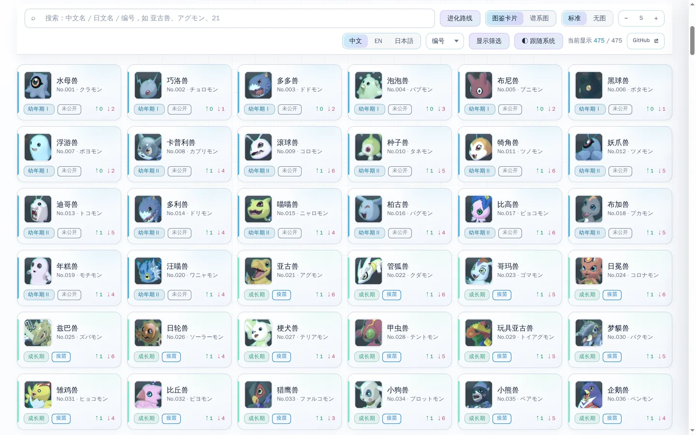

# 数码宝贝物语 时空异客 · 全进化关系图鉴

《Digimon Story: Time Stranger》475 只数码兽的离线图鉴与谱系图，单个 `index.html` 即可运行，无构建、无依赖、可离线打开。

**在线预览 / Live demo**：https://kazuko2012.github.io/digimon-time-stranger-guide/

An offline field guide and evolution-graph explorer for all 475 Digimon in *Digimon Story: Time Stranger*. Everything runs from a single `index.html` — no build step, no runtime dependencies.

## 多语言 / Languages

顶部工具栏可切换 **中文 / English / 日本語**（桌面在右侧按钮组，手机在工具栏第二行靠左），并记忆上次选择、支持深链 `?lang=en` / `?lang=ja`。
名称、简介与全部界面术语（阶段、属性、类型、性格、条件、技能数值、耐性）均本地化；英文与日文名称、简介取自 [digimon.net](https://digimon.net/) 官方图鉴。


## 使用场景 / Use cases

下面按「你此刻想干什么」列出常见场景、操作路径和对应的功能点。每个场景都能在在线版或离线单文件里直接完成。

### 场景速查

| 你的处境 | 用哪个视图 / 功能 | 关键操作 |
|---|---|---|
| 想知道某只怎么进化来、需要什么条件 | 图鉴卡片 → 详情抽屉 | 搜名字/编号 → 打开卡片 → 看「进化条件」与「可退化自（进化前）」 |
| 手里有某只，想知道它能进化成谁 | 详情抽屉 →「可进化为」列表 | 悬停任一条目即可看到该形态的进化条件 |
| 想从 A 精确育成到 B，看最短路线 | 谱系图 →「进化路线查询」 | 选起点/终点 → 勾「允许退化」→ 得到最短链与同长度备选 |
| 想理解某只在整个谱系里的位置 | 谱系图 | 以它为中心，`↑N` 上溯、`+N` 下展，瀑布大纲逐代看 |
| 图鉴收集查漏 | 图鉴卡片 + 筛选 + 排序 | 按阶段/属性/条件筛，按编号排序，编号三位补零搜索 |
| 规划数值与性格 | 详情抽屉「等级数值」「Lv.99 各性格数值」 | 对照 Lv.1 / Lv.99 七项与各性格数值，★ 标该兽初始性格 |
| 玩日文版 / 查日文原名 | 主界面语言 + 详情卡独立语言 | 顶部 中文 / EN / 日本語，抽屉里可单独切某张卡的语言 |
| 边玩边用手机查 | 手机版全屏抽屉 | 卡片点开即全屏，`‹ 返回` 回列表，顶栏 `‹ ›` 翻相邻编号 |
| 把某只/某个谱系发给朋友 | 复制链接（深链） | 抽屉右上复制按钮，或用 `?view=lineage&d=092` 这种地址 |
| 断网、拷 U 盘、发给别人 | 单文件版 | `dist/digimon-guide-vX.html`，双击即开，2.9 MB 带全 475 图标 |

### 1. 开荒期：这只怎么进化出来？要什么条件？

最常见的用法：打到一只没见过的数码兽，想回头补育成。

1. 顶部搜索框输入中文名、日文名或编号（`112` 会自动补成 `No.112`）。
2. 点开卡片，右侧（手机为全屏）详情抽屉里看三块：
   - **进化条件**：如 No.112 巫师兽需要「探员等级 3 以上 + SP 上限 500 以上 + 智力 630 以上」；
   - **可退化自（进化前）**：列出 3 只来源（比丘兽 / 小妖兽 / 德拉库兽），点条目跳到对应图鉴；
   - **可进化为（进化后）**：列出后续形态。

> 想确认「进化成某个形态要什么条件」时，不必逐只点开：在「可进化为」列表里**悬停**任一条目，就会浮出该形态的进化条件卡。

### 2. 目标育成：从 A 到 B 的最短进化链

准备养一只究极体，但不确定中间要经过谁。

1. 切到谱系图（`L` 键或顶部「谱系」）。
2. 用「进化路线查询」面板选起点和终点（可以直接输入名字或编号）。
3. 需要走退化路线就勾上「允许退化」。
4. 面板给出**最短进化链**（逐级列出中间形态）以及**同长度的备选路线**，点任一路线即在地图里高亮居中。

### 3. 素材兽盘点：这只还能变成什么？

1. 在卡片页搜到手上的这只，打开详情。
2. 看「可进化为（进化后）」有几只、分别是哪些阶段；
3. 想看更远的分支，点抽屉底部「在谱系图中查看「XX」的全部前后」——直接带着它跳到谱系图并展开上下代。

### 4. 图鉴收集查漏

1. 展开「显示筛选」：阶段（幼年期Ⅰ/Ⅱ、成长期、成熟期、完全体、究极体、超究极体、装甲体、混合体）、属性、进化条件（无需条件 / 需等级 / DLC）三组可叠加。
2. 用「排序」切换 编号 / 名称 / 阶段，`↑ / ↓` 切换升降序。
3. 想把列表压缩成纯文字清单：图片密度切到「无图」，或把卡片大小调到 XS。
4. 筛选是否生效看顶部摘要条，一键「清除」全部筛选。

### 5. 数值与性格规划

详情抽屉下半部分是 Lv.1 / Lv.99 对照表（HP、SP、攻、防、智、精、敏、合计）以及「Lv.99 各性格数值」——表里 ★ 标出该兽的初始性格，方便你判断要不要洗性格、值不值得投喂。

### 6. 多语言 / 日文原名对照

- 顶部工具栏切 中文 / EN / 日本語 会整站切换（名称、阶段、属性、类型、性格、条件、技能、耐性都本地化）。
- 玩日文版时更实用的是**详情卡独立语言**：抽屉顶栏的 `中文 / EN / 日本語` 只切当前这张卡，界面按钮仍是你的主语言（返回、上一只/下一只、第 N / 475 只不会被带走）。
- 想直接把某个语言版本发人：`?lang=ja` 或复制按钮生成的链接。

### 7. 图谱全局：它在整个谱系里的位置

- 以任一只为中心，中心环与光晕按阶段配色；
- 节点左 `↑N` = 还有 N 条直系进化源未显示，点一下往上拉一层；右 `+N` 往下展开一层；
- 悬停节点会高亮「该节点 → 中心」的整条链，其余分支淡出；
- 右下鹰眼缩略图定位视口；「瀑布大纲」按世代罗列整条谱系（含折叠分支）；
- 多选两只以上可并排比较各自路线；`F` 适应窗口，滚轮缩放锚定光标，双击空白回正。

### 8. 手机现场查（边玩边查）

- 卡片页点任意一只 → 详情占满整屏，左上 `‹ 返回` 回列表；
- 顶栏 `‹ ›` 翻相邻编号，中间显示「第 N / 475 只」；语言组在第二行靠左，不与右上复制/关闭按钮重叠；
- 顶栏在手机上随内容滚动（不吸顶），不会再横在正文中间挡住「进化条件」；
- 谱系页左栏收成左下角「› 展开列表」，点开是全屏 475 只列表；画布单指拖动、双指缩放。

### 9. 分享与讨论

抽屉右上角复制按钮会把当前状态生成一条**深链**，对方打开即还原到同一只/同一个谱系。支持的参数：

| 参数 | 作用 | 示例 |
|---|---|---|
| `view` | `cards` 图鉴卡片 / `lineage` 谱系 | `?view=lineage` |
| `d` | 谱系中心编号 | `?view=lineage&d=092` |
| `n` / `dr` | 直接打开某只的详情卡 | `?d=092&dr=112` |
| `q` | 预填搜索词 | `?q=暴龙` |
| `from` / `to` | 预填路线查询起点/终点 | `?from=001&to=475` |
| `lang` | `en` / `ja` | `?lang=ja` |
| `theme` / `thm` | `light` / `dark` | `?theme=dark` |
| `fs` `fa` `fc` | 阶段 / 属性 / 条件筛选（`.` 分隔） | `?fs=究极体.完全体` |
| `dens` / `spr` / `size` | 图片密度 `normal`/`none`、单图 `file`/精灵图 `sprite`、卡片宽度 168/196/240/296/360 | `?dens=none` |

页面本身**不往地址栏写状态**：正常使用时关掉再开就是默认状态，只有你主动复制的分享链接才会带上这些参数。

### 10. 离线 / 拷贝给别人

```bash
python3 scripts/build_single.py
# → dist/digimon-time-stranger-guide-single.html（图标 base64 内嵌，约 2.9 MB）
```

单文件版放到 U 盘、聊天工具里直接发都行，断网双击即开，和在线版功能一致（图片、语言、谱系全都在文件里）。

### 11. 自己维护数据 / 二次开发

- 词条在 `data/digimon-475.csv`（编号 / 名称 / 阶段 / 属性 / 条件 / 说明），数值在 `data/digimon-lv99.csv`；
- 图标按编号命名放 `assets/icons/001.webp … 475.webp`；
- 改完运行 `scripts/build_single.py` 校验图标是否齐全（会打印 `icons: 475`）；
- 推 `main` 即由 GitHub Actions 发到 Pages（`Settings → Pages → Source` 选 **GitHub Actions**）。

## 预览 / Screenshots

**图鉴卡片视图**：475 只全列表，卡片左缘阶段色条 + 阶段/属性/关系数徽标；顶部搜索、视图切换、「标准 / 无图」密度与卡片大小步进器；筛选默认收起，点「显示筛选」展开阶段 / 属性 / 条件三组筛选。



**谱系图视图**：以亚古兽为中心，中心环与光晕随阶段配色；左侧窄栏 475 只可切换，节点左 `↑N` 上溯、右 `+N` 下展，连线为进化关系（无箭头）。


**详情抽屉**：进化条件、Lv.1 / Lv.99 各性格数值、种族耐性与技能、图鉴说明；「可进化为」列表里鼠标悬停任一条目，即显示进化成该形态所需的条件。


---

## 功能 / Features

**图鉴卡片 / Card view**

- 475 只数码兽，编号、中文名、日文名、阶段、属性、进化条件
- 图片密度两档：标准 / 无图；卡片大小五档步进器；图片加载方式两种：单图按需 / 精灵图切片
- 阶段、属性、条件三组筛选，可叠加；一键清除全部筛选
- 点击卡片打开详情抽屉：基础数值、Lv99 数值、属性抗性、技能、进化条件、图鉴说明

**谱系图 / Lineage view**

- 以任意一只为中心，逐层展开后代与祖先，可无限上溯
- 节点左侧金色 `↑N` = 还没显示的直系进化源数量，点击往上拉出一层
- 节点右侧蓝色 `+N` = 还没显示的直系下一代数量，点击往下展开一层
- 滚轮缩放（锚定光标位置）、拖拽平移、双击空白适应窗口、`适应窗口` 按钮
- 悬停高亮「该节点 → 中心」的整条链，弱化无关分支
- 折叠逐步展开，展开/收起保持当前视角不跳
- 进化路线查询：任选两只，算出最短进化链与同长度备选路线
- 瀑布大纲：按世代列出本谱系全部节点（含折叠分支），点条目自动展开路径并居中
- 鹰眼缩略图：右下角 220×150 全谱系缩略图，白框标中心、青框标当前视口，点击/拖动快速平移
- 多选：同时选中多只，比较各自的进化路线
- 左栏可一键收起 / 展开，画布占满；谱系内筛选为浮层，回卡片页自动恢复

**通用 / Common**

- 详情侧栏可左右拖动调宽（双击回到半屏），顶部一键「半屏 / 全屏」，宽度与状态会被记住
- 深浅双主题，选择会被记住
- 搜索支持中文名 / 日文名 / 编号（编号自动三位补零）
- 记忆上次状态：视图、中心、搜索词、筛选组合
- 深链：地址栏自动带 `?view=lineage&d=092&q=暴龙`，可直接分享某个谱系
- 键盘：`/` 聚焦搜索，`← →` 切换相邻编号，`L` 谱系图，`C` 图鉴卡片，`F` 适应窗口，`Esc` 关闭浮层
- 无障碍：焦点环、`aria-label`、`prefers-reduced-motion` 时关闭动效
- 移动端：谱系页左栏收起为左下角「› 展开列表」全屏抽屉（475 只可滚动筛选），单指拖动平移、双指缩放；工具栏紧凑排布
- GitHub 入口：工具栏最右侧「GitHub ↗」按钮（新窗口打开本仓库），卡片页页脚另有文字链接

## 目录结构 / Layout

```
.
├── index.html                # 主页面（唯一运行文件）
├── assets
│   ├── icons/                # 475 张图标，001.webp … 475.webp，112×112
│   └── sprites/              # 精灵图：sprite-56 / 112 / 160.webp
├── data
│   ├── digimon-475.csv       # 词条数据（编号 / 名称 / 阶段 / 属性 / 条件 / 说明）
│   └── digimon-lv99.csv      # 各性格 Lv99 数值
├── scripts
│   └── build_single.py       # 打成一个自包含的离线单文件版
├── docs                     # README 用真实截图
│   ├── screenshot-deck.webp
│   ├── screenshot-lineage.webp
│   └── screenshot-drawer.webp
└── .github/workflows/pages.yml   # 推 main 自动发布到 GitHub Pages
```

## 本地运行 / Run locally

```bash
# 直接双击 index.html 也行；用本地服务更稳妥（避免个别浏览器对本地图片的限制）
python3 -m http.server 8000
# 打开 http://localhost:8000
```

## 打包单文件版 / Build a standalone file

```bash
python3 scripts/build_single.py
# 产出 dist/digimon-time-stranger-guide-single.html（图标 base64 内嵌，约 2.9 MB）
```

单文件版可以拷到 U 盘或直接发给别人，断网、无服务器也能打开。

## 部署 / Deploy

推到 `main` 分支后，GitHub Actions 会把这个仓库发布到 GitHub Pages：

`https://kazuko2012.github.io/digimon-time-stranger-guide/`

仓库设置里把 **Settings → Pages → Source** 选为 **GitHub Actions** 即可。

## 更新说明 / Changelog

### v1.10.3 — 2026-11-22 · 手机端顶栏不再悬浮压住内容

- 手机 / 窄屏（≤900px）下详情卡顶栏不再 `sticky`：iOS Safari 里粘性定位会在抽屉滚动容器中悬在页面中间，盖住「进化条件」「可退化自」等正文
- 窄屏顶栏改为随内容正常滚动（打开时在最上方，滚动后自然离开视野），并去掉底色块，避免出现横在卡片中间的白色/深色横条
- 桌面与宽屏（>900px）仍保留吸顶行为，滚动时上一只/下一只始终可见

##### v1.10.2 — 详情卡语言只管内容，不管界面

- 抽屉语言按钮只切卡片内容（名称、条件、类型、性格、描述、进化列表）
- `‹ 返回`、`上一只 / 下一只`、`第 N / 475 只`、`半屏 / 全屏` 等界面文案固定跟随主界面语言
- 修复卡片切成外语后主界面 EN/JA 残留中文正文的问题

##### v1.10.1 — 修复窄屏详情卡顶栏错位

- ≤820px 上一只/下一只只显示 `‹ ›` 箭头、语言组换行靠左，序号 `nowrap` 不断行

## 数据来源 / Data

- 数值与图鉴说明整理自日版攻略站 AppMedia 的《时空异客》图鉴页（含 DLC 数码兽）
- 进化条件文本做了中文意译，与游戏内原文可能有措辞差异，以游戏内为准
- 图标来自游戏内素材，仅作同人图鉴用途

## 声明 / Disclaimer

本项目是非商业性质的同人整理作品。《数码宝贝》系列角色、名称、图像版权归 Bandai Namco Entertainment 及各自权利方所有。代码部分以 MIT 许可开源，素材版权不随代码许可转让。若权利方有异议，会立即下线相关内容。

This is a non-commercial fan project. All Digimon characters, names and artwork belong to Bandai Namco Entertainment and their respective owners. The source code is released under MIT; the license does **not** extend to third-party game assets.

## 许可 / License

代码：MIT（见 `LICENSE`）。素材：版权归原权利方，仅限学习交流。
